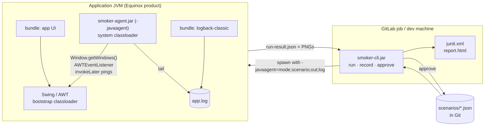
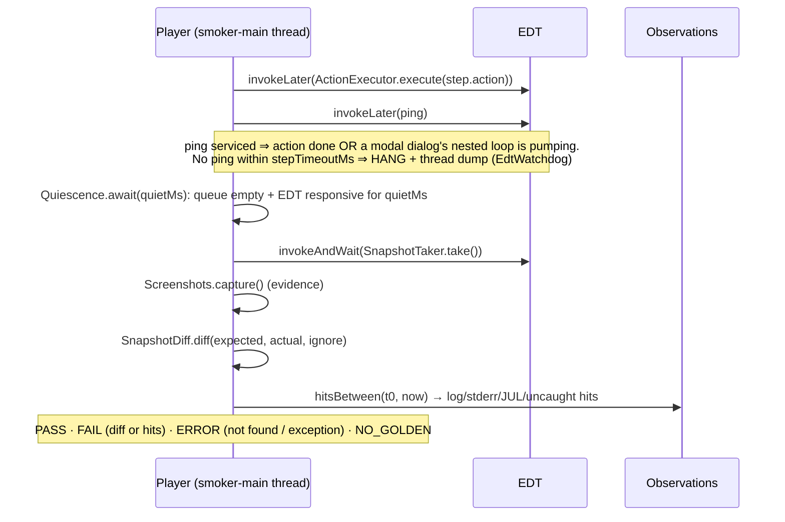

# s.smoker — Architecture v0.1

Status: skeleton implemented and self-tested (Linux/Xvfb, JDK 21 compiling `--release 8`) · 2026-10-19

## 1. Shape

Three decisions carry the design:

1. **In-process agent, no instrumentation.** `premain` only installs hooks; nothing is rewritten. Swing is on the
   bootstrap classpath, so `Window.getWindows()` and `Toolkit.addAWTEventListener` see every window no matter which
   OSGi bundle created it. Works on JRE 8 (`-javaagent` since Java 5) and is Equinox-transparent.
2. **Semantic oracle, semantic replay.** State = component tree (type, name, text, enabled, selection, row counts),
   not pixels. Replay = `doClick()`, `setText()`, `setSelectedIndex()` and synthesized AWT events on the EDT.
   No OS focus, no mouse, no DPI/LAF dependency → a Windows-recorded scenario replays on a Linux Xvfb runner.
   Screenshots are evidence only.
3. **The agent is autonomous; the CLI is orchestration.** One JVM per scenario; the agent writes
   `run-result.json` and exits. The CLI aggregates into JUnit XML + HTML. No socket protocol, no shared state.

## 2. Module map

| Module | Package | Key classes |
|---|---|---|
| smoker-core | `smoker.core.model` | `Scenario`, `Step`, `Action`, `Locator`, `Snapshot`, `NodeSnapshot`, `IgnoreRules`, `RunResult` |
| | `smoker.core.diff` | `SnapshotDiff` — path-keyed attribute diff with ignore rules |
| | `smoker.core.io` / `.report` | `Json` (Gson, pretty, stable), `JUnitXmlWriter`, `HtmlReportWriter` |
| smoker-agent | `smoker.agent` | `SmokerAgent` (premain), `AgentConfig`, `Observations` (+`LogTailer`), `EdtWatchdog`, `Quiescence`, `Locators`, `SnapshotTaker`, `ActionExecutor`, `Player`, `Recorder`, `RecorderToolbar`, `Screenshots` |
| smoker-cli | `smoker.cli` | `Main` — `run` / `record` / `approve` |
| smoker-demo | `smoker.demo` | `DemoApp` + `scenarios/greet.json` + `scenarios-failing/` |

Gson is relocated to `smoker.shaded.gson` in both shaded jars (R-03). The agent jar has no other dependency.

## 3. Play-mode step lifecycle

**Modal dialogs** are the classic trap: `doClick()` on a menu item that opens `JOptionPane` never returns until the
dialog closes. The player therefore never waits for the action `Runnable` itself; it waits for a *subsequent ping*,
which a modal dialog's secondary loop services. Only true silence is a hang.

**Startup** is a pseudo-step: first `Frame` showing within `startupTimeoutMs`, quiet, no log hits (R-14).

## 4. Observing logs inside OSGi (R-10, R-15)

| Source | Mechanism | Reaches Logback-in-a-bundle? |
|---|---|---|
| Log files | `LogTailer`: tail from current end, rotation-aware, regex fail/allow rules, timestamp-correlated to the step | **Yes** — primary mechanism |
| Uncaught exceptions | `Thread.setDefaultUncaughtExceptionHandler` + `sun.awt.exception.handler` (Java 8 EDT) | n/a |
| stderr | `System.setErr` tee | catches `printStackTrace()` |
| java.util.logging | root `Handler`, WARNING+ | only JUL users |
| Phase 2: in-JVM Logback events | fragment bundle `Fragment-Host: ch.qos.logback.classic` with an `AppenderBase` that pushes `(level, logger, message)` into a `java.util.function.Consumer<String>` stored in `System.getProperties()` (bootstrap-visible type, no class sharing needed); configured in `logback.xml` | Yes, with the fragment deployed in the test product |

Tailing is enough for a smoke tester and keeps the agent free of any classloader coupling; phase 2 adds
sub-second attribution and MDC fields if needed.

## 5. Locators and snapshots

- `Locators.resolve(Component)` → `#name` when `setName()` was called (auto names like `null.contentPane`,
  `OptionPane.button`, `frame0` are rejected) else `[window] Class('text')[index]` + window-relative x/y.
- Menu items are reached through `JMenu.getMenuComponents()` even while the popup is closed; popup items
  (combo lists, context menus) resolve their window through `JPopupMenu.getInvoker()`.
- `SnapshotTaker` walks only visible components and skips LAF internals (`javax.swing.plaf.*`, combo arrow buttons,
  scroll-bar buttons, table-header internals) so Metal-on-Linux and Windows-LAF goldens agree.
- Paths: `[Title]/#orders.table`, `[#orders.frame]/#orders.panel/JButton[0]` (WP-02 design, section 4.2); `IgnoreRules.paths` are regexes on this string.
- Locator lint: every visible interactive component without a name is listed in `RunResult.unnamedComponents`.

## 6. Recorder (R-20, R-26)

`Recorder` is an `AWTEventListener` (mouse, key, focus). Mapping:

| User does | Recorded |
|---|---|
| clicks button / menu / menu item | `CLICK #name` |
| types in a text component, leaves it (or presses ENTER) | `SET_TEXT #name = "…"` (diffed on focus loss) |
| picks a combo item, list row, table row, tab | `SELECT #name = value/index` (read back after Swing processed the click) |
| ENTER / ESC / TAB / DELETE / F-keys / Ctrl+… | `KEY value` (VK name, modifiers) |

After each recorded action, a background thread waits for quiescence and stores the golden snapshot of the step.
Save writes the scenario and the golden file `<scenario>.golden.json` (the recording run defines v1 of the golden). `RecorderToolbar` (named `smoker.toolbar`, always-on-top) offers
Record/Pause, Pick (hover → red border + locator + "unnamed" warning), Rename, Delete, Save. Everything named
`smoker.*` is excluded from recording and snapshots.

## 7. Run matrix and environment facts

| Dimension | Note |
|---|---|
| JRE 8 vs 9+ | `--release 8`; no `sun.*` except the legacy EDT handler property; `Process.waitFor(timeout)` is Java 8 |
| Windows runner | runner process must be in an interactive session: `Robot` (screenshots) fails in Session 0; replay/snapshots do not need it |
| Linux runner | `xvfb-run -a`; Metal LAF; no window manager → OS focus is absent, `KEY` actions target the front window's last focus owner or root pane (default button / ESC bindings still fire) |
| macOS | works; `com.apple.laf.*` internals excluded from snapshots |
| HiDPI | irrelevant to the oracle; screenshots differ, by design not compared |

## 8. Roadmap

| Phase | Item | Req |
|---|---|---|
| 1 | Robot fallback for native `FileDialog`/OS prompts (`type: "ROBOT_CLICK"` with screen-relative coords) | R-31 |
| 1 | `approve --diff` interactive promotion in the HTML report (checkbox per difference → patch file) | R-33 |
| 1 | Matrix labels (`--label jre8-win`) merged into one report; run history JSON for flakiness | R-41, R-42 |
| 2 | Logback fragment bridge | R-15 |
| 2 | Hints API jar: `Smoker.markDynamic(component)`, `Smoker.busy()/idle()` for long async work | R-05 |
| 2 | Screenshot oracle with tolerance (opt-in per step) | R-24 |
| 3 | Recorder: step grouping ("functionality" header), inline rename, snapshot preview tree | R-26 |
