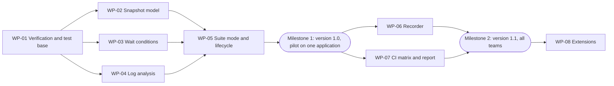

# s.smoker — Audit and Development Plan v0.2

Date: 2026-11-11. Input: `requirements.md` v0.1, `architecture.md` v0.1, skeleton 0.1.0-SNAPSHOT.
Language: Simplified Technical English (ASD-STE100 rule categories). Effort values are estimates in person-days (pd).

## 1. Glossary

| Term | Meaning |
|---|---|
| application | The Swing software that s.smoker tests. |
| agent | `smoker-agent.jar`. It operates in the JVM of the application. |
| scenario | One JSON file. It contains the steps for one function of the application. |
| step | One action and the state that the application must show after the action. |
| golden snapshot | The approved state of the user interface after a step. |
| hit | A log line or an exception that agrees with a fail rule. |
| simulator | The software that replaces the hardware during a test. |

## 2. Audit result

The architecture is correct for the purpose. Keep these three decisions:

1. The agent operates in the JVM of the application and does not change bytecode.
2. The agent compares component states, not pixels.
3. The agent replays actions through the Swing API, not through the mouse of the operating system.

The audit found 18 defects or gaps. Severity A stops the use on a real application. Severity B causes incorrect results or high maintenance cost. Severity C decreases quality.

| ID | Sev. | Finding | Correction | Work package |
|---|---|---|---|---|
| F-01 | A | No test on a real Equinox application exists. No test on JRE 8, JRE 11, JRE 17 or Windows exists. The skeleton operated only on JDK 21 with Xvfb. | Do a verification test on one real application before all other work. | WP-01 |
| F-02 | A | The agent waits only for an empty event queue. The application gets answers from the simulator after an unknown delay. The agent will record the state too early. | Add the action `WAIT_FOR`. It waits until a component attribute agrees with a value, or until a timeout occurs. WP-03 is implemented on the branch (2026-11-16). F-02 is fixed in the tool. It is not tested on a product with the hardware simulator: no such product is available. | WP-03 |
| F-03 | A | Each scenario starts a new JVM. An Equinox application can use 20 s to 60 s to start. 50 scenarios can use 50 minutes for startup only. | Add a suite mode. One JVM runs many scenarios. Start a new JVM only after FAIL, HANG or ERROR. | WP-05 |
| F-04 | A | No procedure starts or resets the simulator and the test data. | Add `before` and `after` commands to the suite file. Add a reset action between scenarios. | WP-05 |
| F-05 | B | A path contains position indexes, for example `JPanel[0]`. One new panel in the layout changes all paths below it. All golden snapshots then fail. | Start each path at the nearest named component. Compare all components that show state by default (decision 7) and give the option `named`. Done in WP-02. | WP-02 |
| F-06 | B | The scenario file contains one full component tree for each step. Five steps make more than 800 lines. A person cannot review the file in Git. | Put the golden snapshots in a second file, `<scenario>.golden.json`. Store the first snapshot fully. Store only the changes for each subsequent step. Done in WP-02. | WP-02 |
| F-07 | B | A table snapshot contains only the row count. A tree snapshot contains only the row count. Incorrect cell values pass. | Record the cell text of the first N rows, the list items and the visible tree labels. N is a parameter. Done in WP-02. | WP-02 |
| F-08 | B | The log reader reads the file each 150 ms. The step can end before the reader reads the last lines. The agent then assigns a hit to the incorrect step. | Read the log file to its end before the agent closes each step. | WP-04 |
| F-09 | B | Each line of a stack trace is a separate hit. The default fail rule finds the word `Error` in normal text. | Parse the Logback pattern. Use the level field for the fail rule. Join the lines of one stack trace into one hit. | WP-04 |
| F-10 | B | The agent calls `System.exit`. An OSGi framework does not stop its bundles correctly then. Lock files and a damaged workspace can remain. | Close the windows first. Stop the framework if it is present. Call `System.exit` only after a timeout. | WP-05 |
| F-11 | B | The agent arguments use `;`, `,` and `=` as separators. A path that contains one of these characters breaks the configuration. | Accept one argument: `config=<file>`. Put all parameters in that properties file. | WP-05 |
| F-12 | B | The semantic snapshot cannot see a component that paints its own content, for example a map or a tactical display. | Add an interface to the hints API. The component supplies its state as text. Add a screenshot comparison for one region as the alternative. | WP-08 |
| F-13 | B | The recorder ignores the right mouse button, the double-click, tree selection, table cell editors, spinners and drag operations. | Add these event types one at a time. Start with tree selection, the double-click and the context menu. | WP-06 |
| F-14 | B | No person operated the recorder toolbar. Only a code review examined it. | Do a usability test with two developers on Windows. | WP-06 |
| F-15 | C | The skeleton contains no unit test. The self-test is a shell script and does not run on Windows. | Add JUnit tests for the diff, the locators and the JSON format. Change the self-test into a Maven integration test. | WP-01 |
| F-16 | C | `AgentConfig` calls `toUpperCase()` without a locale. In the Turkish locale the letter `i` changes to `İ`. A value such as `evidence` can then fail to parse. | Use `Locale.ROOT` for all case changes. Run the tests with `-Duser.language=tr`. | WP-01 |
| F-17 | C | The scenario format has no version field. Two components can have the same name. The lint does not report this. | Add `schemaVersion`. Make the lint report each name that occurs more than one time in a window. Done in WP-02. | WP-02 |
| F-18 | C | Requirements R-05, R-15, R-34, R-41 and R-42 have no implementation. No requirement has an acceptance criterion or a priority. | Section 3 adds priorities and criteria. WP-07 and WP-08 implement the open requirements. | WP-07, WP-08 |
| F-19 | A | The snapshot and the recorder read the text of a `JPasswordField`. A password or API key then goes into the scenario file, the golden snapshots and the reports in plain text. Found on 2026-11-14 in the settings dialog of p.osgi.ds. | Give a password field as `***` (or empty) in the snapshot. Do not record typing in a password field. Done in WP-01. | WP-01 |
| F-20 | A | The recorder recorded a button click on `MOUSE_CLICKED`. Swing fires the action on `MOUSE_RELEASED`. If the action opens or closes a modal dialog, no `MOUSE_CLICKED` arrives, and the recorder loses the step. Found on 2026-11-14 in p.osgi.ds: the clicks on Settings and Cancel were lost (3 of 5 steps). | Record buttons and menu items on `MOUSE_RELEASED` when the model fires the action. Done in WP-01. | WP-01 |
| F-21 | B | The recorder takes the golden snapshot of a step after the UI is quiet for `quietMs`. If the next action comes before that time, the snapshot shows the state after the next step. Found on 2026-11-14 in p.osgi.ds: `SET_TEXT` is recorded when the field loses focus, which is the press on the next button. The goldens of s002 and s004 showed the state after s003 and s005. `approve` corrects the goldens, but the player stops at the first failing step, so each `approve` corrects one step. | Take the snapshot of a step before the recorder adds the next step. Let `approve` continue after a failing step, or replay all steps in approve mode. WP-02 part done (WP-06 owns the rest). | WP-02, WP-06 |
| F-22 | B | The agent reads `System.err` and the log file. Equinox writes framework errors to the console (`-consoleLog`) and to `configuration/*.log`. Found on 2026-11-14 in p.osgi.ds: on JRE 8, 14 bundles of spike.master did not resolve, and startup was PASS. When the application calls `System.exit`, the report gives only the exit code. The step and the last ERROR line are only in `app-output.log`. | Read the Equinox log, or fail on `FrameworkEvent ERROR` in the application output. Write the step and the last log hits to `run-result.json` before each action. | WP-04 |
| F-23 | A | `Locators.resolve` counts the index among components of the same class. `Locators.find` also accepts a component whose superclass has the locator class. `JPasswordField` extends `JTextField`, so the locator `JTextField` index 0 finds the password field in front of the first text field. Found on 2026-11-14 in p.osgi.ds: step s002 typed the model name into the API key field. `approve` accepted the wrong state, and the run gave PASS. | In `find`, use the same class rule as in `resolve`: the simple class name, or the superclass name only for an anonymous class. Add a test with a `JPasswordField` in front of a `JTextField`. Done in WP-01. | WP-01 |
| F-24 | C | `approve` on a run without `run-result.json` stops with a `NoSuchFileException` stack trace and exit code 1. `lint` gives a message and exit code 2 in the same case. Found on 2026-11-16 on Windows: `crash.json` exits through `System.exit` before the agent writes `run-result.json` (F-22). | Give a message and exit code 2, as `lint` does. | WP-04 |

One more risk has no technical correction: a locator without a name uses the visible text. The locator fails when the language of the user interface changes. The rule must be: each interactive component gets a name.

## 3. Changed and new requirements

Priority M = necessary for version 1.0. Priority S = necessary for version 1.1. Priority C = optional.

| ID | Pri. | Requirement | Acceptance criterion |
|---|---|---|---|
| R-23a | M | The agent shall have a `WAIT_FOR` action with locator, attribute, regular expression and timeout. | A scenario waits for a label that changes 3 s after a click. The step passes. |
| R-25a | M | The tool shall keep golden snapshots in a file apart from the scenario file. | A scenario file with 10 steps has fewer than 80 lines. |
| R-30a | M | The default comparison shall use all components that show state, paths anchored at the nearest named ancestor or the window (decision 7). A comparison of named components and window titles only shall be an option. | A new unnamed panel in the layout causes no difference, in mode `all` and in mode `named`. |
| R-23b | M | A snapshot shall contain cell text for the first N rows of a table, list items and visible tree labels. | An incorrect cell value in row 1 causes FAIL. |
| R-10a | M | The agent shall read each log file to its end before it closes a step. | 100 repeated runs assign the hit to the correct step each time. |
| R-12a | M | The fail rule shall use the log level. One stack trace shall be one hit. | One exception with 40 trace lines gives one hit. |
| R-36 | M | The tool shall run many scenarios in one JVM. It shall start a new JVM after FAIL, HANG or ERROR. | 20 scenarios that pass use one application startup. |
| R-37 | M | The suite file shall contain `before`, `after` and `reset` commands. | The `before` command starts the simulator. The `after` command stops it also after a failure. |
| R-38 | M | The agent shall stop an OSGi application through the framework before it calls `System.exit`. | No lock file remains in the workspace after 20 runs. |
| R-39 | M | The agent shall get its configuration from one properties file. | A path with `;` and spaces operates correctly on Windows. |
| R-02a | M | The CI pipeline shall run the integration test on JRE 8, 11, 17 and 21, on Windows (decision 5). | All four jobs pass. |
| R-22a | S | The lint shall report missing names and names that are not unique. An option shall change lint results into failures. | A window with two components named `x` gives one lint result. |
| R-20a | S | The recorder shall record tree selection, the double-click, the context menu, table cell edits and spinner values. | A replay of each recorded type passes on the demo application. |
| R-34 | S | The agent shall set locale, time zone, look and feel and window size from the configuration. | The same scenario passes with operating system locale `tr_TR` and `en_US`. |
| R-41, R-42 | S | The report shall join the results of all matrix jobs. It shall show the step results of the last 20 runs. | One report shows four matrix columns. |
| R-05, R-15 | C | Hints API and Logback fragment (see WP-08). | See WP-08. |
| R-40a | M | The build shall prevent the release of an application that contains the agent option. | A release build with `-javaagent:smoker` in `eclipse.ini` fails. |

## 4. Development plan

### 4.1 Sequence

WP-02, WP-03 and WP-04 are independent. Three developers can do them at the same time.

### 4.2 Work packages

| WP | Title | Findings | Effort (pd) | Result |
|---|---|---|---|---|
| WP-01 | Verification and test base | F-01, F-15, F-16, F-19, F-20, F-23 | 6 | Test report for one real application. Unit tests. Integration test in Maven. |
| WP-02 | Snapshot model | F-05, F-06, F-07, F-17, F-21 | 8 | Golden file apart from the scenario. Named-component comparison. Cell content. |
| WP-03 | Wait conditions | F-02 | 3 | `WAIT_FOR` action in player and recorder. |
| WP-04 | Log analysis | F-08, F-09, F-22, F-24 | 4 | Level-based fail rules. One hit for each stack trace. Correct step assignment. |
| WP-05 | Suite mode and lifecycle | F-03, F-04, F-10, F-11 | 8 | Suite file. One JVM for many scenarios. Clean OSGi stop. Properties configuration. |
| WP-06 | Recorder | F-13, F-14, F-21 | 10 | More event types. Usability corrections. Golden preview. |
| WP-07 | CI matrix and report | F-18 | 5 | Four matrix jobs. Joined report. Run history. Release guard. |
| WP-08 | Extensions | F-12, F-18 | 10 | Hints API. Logback fragment. Robot fallback. Region screenshot comparison. |
| WP-09 | Naming assistant | Risk: components without a name | 6 | Lint with proposed names. Patch lines. Automatic names at run time. |

Total for version 1.0 (WP-01 to WP-05, WP-09): 35 pd. Total for version 1.1 (WP-06, WP-07): 15 pd. WP-08: 10 pd.

### 4.3 Tasks

**WP-01 Verification and test base (6 pd)**

1. Select the smallest Swing application that operates in Equinox.
2. Add the agent option to `eclipse.ini` below `-vmargs`.
3. Start the application in record mode on Windows with JRE 8.
4. Record one scenario with five steps. Save it.
5. Replay the scenario on Windows. (Decision 5 removes the Linux replay.)
6. Write down each failure, the lint result and the startup time.
7. Add JUnit tests for `SnapshotDiff`, `Locators`, `IgnoreRules` and `Json`.
8. Change `selftest.sh` into a Maven integration test in module `smoker-it`.
9. Replace each `toUpperCase()` and `toLowerCase()` call with the `Locale.ROOT` form.
10. Run all tests with `-Duser.language=tr -Duser.country=TR`.

Completion criterion: the five-step scenario passes on Windows with JRE 8. The test report is in the GitHub repository (decision 6). (Decision 5 removes "on Linux with JRE 17".)
Decision point: if the agent cannot attach to the application, stop. Analyze the launcher before you start WP-02.

**WP-02 Snapshot model (8 pd)**

1. Add `schemaVersion` to `Scenario`. Refuse a file with a higher version.
2. Move `expected` from `Step` to the file `<scenario>.golden.json`.
3. Change the path format. A path starts at the nearest named component.
4. Add the comparison mode `named` as the default. Keep the mode `full` as an option for each scenario.
5. Store the first golden snapshot fully. Store each subsequent snapshot as a list of changes.
6. Add cell text, list items and tree labels to `NodeSnapshot`. Add the parameter `maxRows` with the default value 20.
7. Make the lint report names that are not unique.
8. Update `approve` and the HTML report for the new format.

Completion criterion: R-25a, R-30a and R-23b pass. A golden file for 10 steps on the demo application has fewer than 150 lines.

**WP-03 Wait conditions (3 pd)**

1. Add the action type `WAIT_FOR` with the fields `locator`, `attribute`, `matches` and `timeoutMs`.
2. Make the player examine the condition each 100 ms on the EDT.
3. Report FAIL with the last value when the timeout occurs.
4. Add a `Wait for…` button to the recorder toolbar. The developer selects a component with the picker.
5. Add a delayed answer to the demo application. Add a scenario that uses `WAIT_FOR`.

Completion criterion: R-23a passes. No scenario for the pilot application uses the action `WAIT`.

State on 2026-11-16: WP-03 is implemented on the branch `wp-03-wait-conditions`. R-23a passes on the demo (`wait.json`, SelfTestIT). No pilot scenario uses `WAIT`. F-02 is not tested on a product with the hardware simulator.

**WP-04 Log analysis (4 pd)**

1. Add the parameters `logPattern` and `failLevel` to the configuration.
2. Parse time, level, logger and message from each line.
3. Add each line that does not start with a time to the event before it.
4. Read each log file to its end before `Player` calls `hitsBetween`.
5. Use the time in the log line to assign the hit when the time is available.
6. Add a test with 100 repeated runs.
7. F-22: fail on Equinox framework errors (`FrameworkEvent ERROR`, unresolved bundles) in the application output or in `configuration/*.log`. Write the current step and the last log hits to `run-result.json` before each action, so that a `System.exit` of the application leaves a result.
8. F-24: `approve` on a run without `run-result.json` gives a message and exit code 2, as `lint` does.

Completion criterion: R-10a and R-12a pass. An unresolved bundle at startup gives FAIL. After `System.exit` in a step, `run-result.json` names that step. `approve` without `run-result.json` gives exit code 2.

**WP-05 Suite mode and lifecycle (8 pd)**

1. Define the suite file `suite.json` with the fields `app`, `agentConfig`, `before`, `after`, `reset` and `scenarios`.
2. Replace the agent arguments with `config=<properties file>`.
3. Make the player run the scenarios in sequence in one JVM.
4. After each scenario, close all dialogs. Then do the `reset` action.
5. After FAIL, HANG or ERROR, stop the JVM. Start a new JVM for the scenarios that remain.
6. To stop, send `WINDOW_CLOSING` to the main window. Wait 10 s.
7. If the JVM continues to operate, stop the OSGi system bundle through reflection. Wait 10 s.
8. If the JVM continues to operate, call `System.exit`.
9. Make the CLI run `before` and `after`. Run `after` also when a scenario fails.

Completion criterion: R-36, R-37, R-38 and R-39 pass. 20 scenarios on the pilot application use one startup.

**Milestone 1: version 1.0.** One team uses the tool on one application in its merge request pipeline for two weeks. Measure the false failures. The target is fewer than 2 % of the runs.

**WP-06 Recorder (10 pd)**

1. Do a usability test with two developers. Each developer records three scenarios. Write down each problem.
2. Record tree selection as `SELECT` with the path of labels.
3. Record the double-click and the right mouse button as `CLICK` with the fields `count` and `button`.
4. Record a table cell edit as `SET_CELL` with row, column and value.
5. Record a spinner value as `SET_TEXT`.
6. Show the changes of the golden snapshot for the selected step in the toolbar.
7. Add the functions to move a step and to add a step group.
8. Correct the problems from task 1.

Completion criterion: R-20a passes. A developer who did not see the tool before records a scenario with 10 steps in less than 10 minutes.

**WP-07 CI matrix and report (5 pd)**

1. Add the parameter `--label` to the CLI. Write the label into `run-result.json`.
2. Add the command `report --merge <dirs>`. It joins the results of all jobs into one HTML file.
3. Keep the step results of the last 20 runs in `history.json`. Show them in the report.
4. Add the four matrix jobs (Windows, JRE 8, 11, 17, 21) to `.gitlab-ci.yml`. Remove the job `smoke:linux`.
5. Add the locale, time zone, look and feel and window size parameters (R-34).
6. Add a Maven Enforcer rule or a script that finds `-javaagent:smoker` in a release build and fails the build.
7. Add the command `lint --baseline <file>`. It writes the current lint results to a baseline file. The pipeline fails only for a result that is not in the baseline file.

Completion criterion: R-02a, R-34, R-41, R-42 and R-40a pass.

**Milestone 2: version 1.1.** All teams can use the tool. The Nexus repository contains the released artifacts.

**WP-08 Extensions (10 pd)**

1. Hints API (3 pd): the interface `SmokerState` with the method `String smokerState()`. A component that paints its own content implements it. Add `Smoker.busy()` and `Smoker.idle()`.
2. Logback fragment (3 pd): a fragment bundle for `ch.qos.logback.classic` with an appender. The appender sends each event to the agent.
3. Robot fallback (2 pd): the action `ROBOT_CLICK` for dialogs of the operating system.
4. Region screenshot comparison (2 pd): an optional comparison of one component image with a tolerance value.

Do each item only when a team needs it.

**WP-09 Naming assistant (6 pd)**

Purpose: decrease the work to give names to the components of an existing application.

1. DONE: For each unnamed component, find the nearest parent that is an instance of an application class.
2. DONE: Use reflection to find the field of that parent that refers to the component.
3. DONE: Write the lint result with these columns: window, application class, field, component type, visible text, proposed name.
4. DONE: Make the proposed name from the view name and the field name. Example: field `saveButton` in `OrdersPanel` gives `orders.btn.save`.
5. DONE: Add the command `lint --emit-patch`. It writes one line of Java for each result, for example `saveButton.setName("orders.btn.save");`, with the class where the developer must add it.
6. DONE: Add the option `autoNames=true`. The agent then uses the name `@<Class>.<field>` at run time for a component without a name. The source code does not change.
7. DONE: Mark each automatic name in the report. An automatic name changes when a developer renames the field.

Completion criterion: on the pilot application, the tool proposes a name for a minimum of 80 % of the unnamed interactive components. A scenario that uses automatic names passes on Windows. Status: met on 2026-11-16. Pilot: 14 of 14 proposals (100 %, `docs/wp-09-pilot-report.md`). The demo scenario `notes.json` passes on macOS (SelfTestIT), and `docs/wp-01-pilot/pilot-autonames.json` passes on Windows with JRE 8. WP-09 is complete.
Sequence: do WP-09 immediately after WP-01. The lint result from WP-01 is its input.

## 5. Risks

| Risk | Probability | Effect | Mitigation |
|---|---|---|---|
| The product launcher prevents the agent option. | Low | The tool cannot be used. | WP-01 finds this in the first week. Alternative: environment variable `JAVA_TOOL_OPTIONS`. |
| Many components have no name. | High | Locators use text and position. Scenarios fail after layout or language changes. | Use the lint result from WP-01 to estimate the work. Use automatic names (WP-09) and `lint --emit-patch` to add real names. Add a naming rule to the code review checklist. |
| Important state is in components that paint their own content. | Medium | The snapshot does not show the state. | Count these components in WP-01. Move the hints API from WP-08 to version 1.0 if the count is high. |
| The simulator gives different answers in each run. | Medium | Golden snapshots fail without a software defect. | Use `ignore` rules and `WAIT_FOR`. Use simulator scenarios that do not change. |
| The Windows runner operates as a service. All smoke tests use Windows runners (decision 5). | Medium | Screenshots fail. Replay and snapshots continue to operate. | Set `screenshots=off` for these runners, or run the runner in a user session. |

## 6. Decisions that the owner must make

1. DECIDED 2026-11-14 (replaces the decision of 2026-11-12): the pilot application for WP-01 is p.osgi.ds.
   The five-step scenario uses `com.kk.pde.ds.product` (`p2.product`). The HANG test uses `com.kk.pde.ds.spike.master.product`.
   Effects: p.osgi.ds has no simulator, no component names, no `eclipse.ini` and no log file.
   WP-01 does not test the simulator risks (F-02, F-04). WP-03 and WP-05 must test them on a product with a simulator.
5. DECIDED 2026-11-15: the smoke tests run on Windows only. The target applications load Windows DLLs and cannot start on Linux.
   s.smoker operates in the JVM of the application, so a Linux runner cannot test them.
   Effects: WP-01 task 5 and the completion criterion have no Linux replay. R-02a has four jobs, not eight. R-41 shows four columns.
   WP-07 removes the job `smoke:linux`. s.smoker itself continues to build and test on macOS and Linux (`xvfb-run`) for its developers.
6. DECIDED 2026-11-15: test reports go into the GitHub repository (`docs/`), not into Confluence. Confluence is not available on the Atlassian site now.
   Move the reports to Confluence when the space `s.smoker` exists.
7. DECIDED 2026-11-15: the default comparison is `all`. It compares all components that show state, unnamed components included.
   Paths start at the nearest named ancestor or at the window. `named` is an option for each scenario. This changes R-30a.
2. Select the number of developers who build s.smoker (not the developers of the application). With three developers, version 1.0 needs approximately three to four calendar weeks. With one developer, it needs approximately seven weeks.
3. DECIDED 2026-11-12: the naming rule `<view>.<widget>` applies to all teams. WP-09 refines it: the proposed names are `<view>.<type>.<field>`, for example `orders.btn.save`. The lint uses a baseline file. Only new lint results fail the pipeline.
4. DECIDED 2026-11-12: lint results fail the pipeline from version 1.1.
